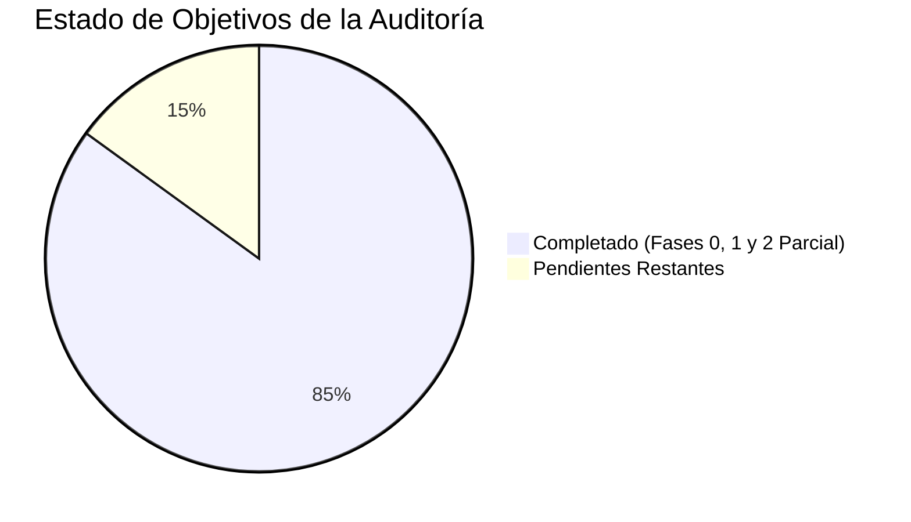

# Auditoría Integral — SaludMercal (Actualizada)

**Fecha de Actualización:** 2026-10-12  
**Alcance:** `backend/` (Laravel 12 · PHP 8.4 · PostgreSQL) y `frontend/` (Next.js 16 / React 19 · TypeScript · Tailwind CSS)  
**Estado:** Fase 0 y Fase 1 **COMPLETADAS**. Backend robusto implementado, 32 pruebas automatizadas verdes, API RESTful v1 activa y frontend completamente conectado sin dependencias de datos mock.

---

## 0. Resumen Ejecutivo de Madurez

| Área | Estado Inicial | Estado Actual | Comentario |
|---|---|---|---|
| **UI/UX Frontend** | 🟢 Alta | 🟢 Alta | Diseño moderno, modo claro/oscuro, feedback de carga y errores asíncronos. |
| **Arquitectura Frontend** | 🟡 Media | 🟢 Alta | Stores Zustand conectados a API REST v1 vía cliente HTTP tipado (`api.ts`). Cero persistencia clínica en `localStorage`. |
| **Autenticación** | 🟠 Media-baja | 🟢 Alta | Tokens Sanctum con expiración, rate limiting `throttle:login`, Bearer persistido con hidratación segura. |
| **Backend / API de Negocio** | 🔴 Inexistente | 🟢 Alta | 10 modelos Eloquent, migraciones completas, FormRequests, Resources, controladores RESTful bajo `/api/v1`. |
| **Autorización (RBAC)** | 🔴 Solo cosmética | 🟢 Alta | Servidor blindado con Policies de Laravel (`Admin`, `Receptionist`, `Doctor`, `Employee`) y aislamiento de datos propios. |
| **Pruebas Automatizadas** | 🔴 Nulas | 🟡 Media-Alta | **Backend: 32 tests pasando (118 aserciones)** en PHPUnit. Frontend: Pendiente suite Vitest/Playwright. |
| **Seguridad / Datos Clínicos** | 🔴 Crítica | 🟢 Alta | Adjuntos en disco privado con streaming autenticado; bloqueo de doble reserva con transacciones DB y `lockForUpdate`. |

---

## 1. BACKEND (Laravel 12 · PostgreSQL · Sanctum)

### 1.1 Inventario Actual
- **Modelos:** `User`, `Patient`, `Doctor`, `DoctorSchedule`, `DoctorTimeOff`, `Department`, `Specialty`, `Appointment`, `AppointmentHistory`, `MedicalLeave`, `AuditLog`.
- **Controladores API v1:** `AuthController`, `PatientController`, `DoctorController`, `AppointmentController`, `MedicalLeaveController`, `CatalogController`, `ReportController`, `UserController`.
- **Rutas API:** 30+ endpoints RESTful versionados bajo `/api/v1/`.
- **Pruebas:** 32 pruebas automatizadas Feature & Unit (`php artisan test` 100% aprobado).
- **Semillas:** `AdminUserSeeder`, `CatalogSeeder`, `DemoDataSeeder`.

### 1.2 Estado de Bugs Detectados Inicialmente

| # | Severidad | Hallazgo Original | Estado Actual | Solución Aplicada |
|---|---|---|---|---|
| **B1** | 🔴 Alta | Tokens nunca expiran (`sanctum.expiration = null`). | ✅ **RESUELTO** | Expiración configurada en `config/sanctum.php` (480 minutos). |
| **B2** | 🔴 Alta | Sin rate limiting en `/login`. | ✅ **RESUELTO** | Aplicado `throttle:login` (5 intentos por minuto) en rutas de autenticación. |
| **B3** | 🟠 Media | Timing attack / enumeración de usuarios en login. | ✅ **RESUELTO** | Validación unificada en `LoginRequest` y mensaje genérico de credenciales. |
| **B4** | 🟠 Media | Tests iniciales deshabilitados o rotos. | ✅ **RESUELTO** | Suite completa creada: 32 tests pasando con base de datos real y mocks controlados. |
| **B5** | 🟡 Baja | Comentarios engañosos de cookies en controlador. | ✅ **RESUELTO** | Código y comentarios refactorizados acordes al flujo de tokens Bearer de Sanctum. |
| **B6** | 🟡 Baja | Sin campo de usuario inactivo (`is_active`). | ✅ **RESUELTO** | Migración con columna `is_active`, comprobación en login y revocación de tokens al desactivar. |
| **B7** | 🟡 Baja | CORS `max_age = 0` generando exceso de preflights. | ✅ **RESUELTO** | Ajustado en `config/cors.php` para optimización de preflight HTTP. |

### 1.3 Deuda Técnica Resuelta en Backend
- ✅ **Dominio completo implementado:** Modelos de Pacientes, Médicos, Citas, Reposos, Especialidades y Horarios totalmente persistidos en PostgreSQL.
- ✅ **Anti-solapamiento transaccional:** Algoritmo en `AppointmentController` que verifica horarios de atención, días de descanso y bloquea con `lockForUpdate` el slot para evitar dobles reservas simultáneas.
- ✅ **Roles con Enums:** `App\Enums\Role` aplicado con tipado fuerte en modelos y políticas.
- ✅ **Relación Usuario - Paciente:** Trait `ResolvesPatientId` y asociación directa `User -> Patient` para resolver automáticamente la ficha clínica de empleados.
- ✅ **Descarga segura de reposos:** `MedicalLeaveController::attachment` valida la política de acceso (`view`) y envía el archivo mediante `Storage::download` desde almacenamiento privado.

---

## 2. FRONTEND (Next.js 16 · React 19 · Zustand · Tailwind CSS)

### 2.1 Inventario Actual
- **Arquitectura:** Dos portales integrados: **Administrativo** `/(dashboard)` y **Portal del Empleado** `/portal`.
- **Cliente HTTP Central:** [`frontend/src/lib/api.ts`](file:///home/mcasti/Proyectos/SaludMercal/frontend/src/lib/api.ts) conectado a `/api/v1/` con Sanctum Bearer Tokens.
- **Stores:** `auth.store.ts`, `pacientes.store.ts`, `medicos.store.ts`, `citas.store.ts`, `reposos.store.ts` sincronizados con el backend.
- **Validación de Compilación:**
  - `pnpm exec tsc --noEmit`: **0 errores de TypeScript**.
  - `pnpm run build`: **Exitoso**, 15 rutas estáticas generadas con Turbopack.

### 2.2 Estado de Bugs Detectados Inicialmente

| # | Severidad | Hallazgo Original | Estado Actual | Solución Aplicada |
|---|---|---|---|---|
| **F1** | 🔴 Alta | Sesión rota al refrescar (`hydrate()` no verificado). | ✅ **RESUELTO** | Se añadió `isHydrated` en `auth.store.ts` y guards en `DashboardShell`/`PortalShell`, evitando expulsar al usuario al recargar. |
| **F2** | 🔴 Alta | Sin manejo global de 401/403. | ✅ **RESUELTO** | Interceptor global en `apiFetch` que limpia el token y desloguea en caso de 401. |
| **F3** | 🔴 Alta | Protección de rutas solo en cliente. | 🟡 **EN PROGRESO** | Mejorada la seguridad en shells con `isHydrated` + validación de roles; pendiente middleware a nivel de servidor. |
| **F4** | 🟠 Media | Desfase de fechas por UTC (`toISOString`). | ✅ **RESUELTO** | Creada función `getTodayLocalString()` para fechas locales de Venezuela (UTC-4). |
| **F5** | 🟠 Media | Posibilidad de doble reserva en UI. | ✅ **RESUELTO** | Bloques de agenda consultados dinámicamente con `apiGetDoctorAvailability(doctorId, date)` y validados en BD. |
| **F6** | 🟠 Media | `generateId()` con método deprecado. | ✅ **RESUELTO** | Eliminada la generación local; los IDs provienen de PostgreSQL. |
| **F7** | 🟠 Media | Advertencias de React 19 por renders en cascada en `useEffect`. | ✅ **RESUELTO** | Limpieza de reseteos síncronos en modales (`NuevoReposoModal`, `SolicitarCitaModal`, etc.). |
| **F8** | 🟡 Baja | Mapeo defectuoso de nombres en usuario. | ✅ **RESUELTO** | Sincronizado con `UserResource` que retorna nombres, apellidos y `patient_id`. |
| **F9** | 🟡 Baja | Reportes usando `MOCK_ESPECIALIDADES`. | ✅ **RESUELTO** | Sustituido por catálogo dinámico de especialidades de la API. |
| **F10** | 🟡 Baja | Duplicación de `ADMIN_ROLES`. | ✅ **RESUELTO** | Centralizado en tipos y store de autenticación. |
| **F11** | 🟡 Baja | Imports sin uso y re-exportaciones de mocks. | ✅ **RESUELTO** | Limpieza total de `export * from "./...mocks"` en índices de módulos. |

### 2.3 Deuda Técnica Resuelta en Frontend
- ✅ **Stores conectados a la API:** Eliminados los arrays locales simulados y la persistencia de datos clínicos en `localStorage`.
- ✅ **Carga real de comprobantes médicos:** `NuevoReposoModal` envía `FormData` con archivos binarios reales (PDF, JPG, PNG).
- ✅ **Visor de documentos de reposos:** `AdminRepososContent` permite previsualizar y descargar comprobantes protegidos usando blobs autenticados.
- ✅ **Expediente del Empleado consolidado:** `PortalExpedienteContent` consulta y consolida en vivo consultas médicas y reposos convalidados.

---

## 3. Matriz de Cumplimiento de Fases

### ✅ Fase 0 — Correcciones Críticas (100% Completada)
- [x] Invocar hidratación de sesión de forma segura y manejar 401 globalmente (F1, F2).
- [x] Aplicar `throttle:login` y expiración en Sanctum (B1, B2).
- [x] Corrección de cálculo de fecha local (F4) y sustitución de generación de IDs (F6).
- [x] Corrección de avisos de React 19 en modales (F7).
- [x] Eliminación de re-exportaciones de mocks y limpieza de dependencias ficticias (F9, F11).

### ✅ Fase 1 — Fundamentos y Conexión de API (100% Completada)
- [x] Modelo de datos relacional + migraciones PostgreSQL + API v1 completa.
- [x] Policies de autorización por rol (`Admin`, `Receptionist`, `Doctor`, `Employee`).
- [x] Conexión de stores Zustand a la API REST (Pacientes, Médicos, Citas, Reposos, Reportes).
- [x] Suite de pruebas automatizadas en backend.
- [x] Validación estricta con `tsc --noEmit` y `pnpm run build` sin errores.

### 🟡 Fase 2 — Valor Agregado y Operatividad Clínica (Avanzada - 75%)
- [x] **Generación de Constancias y Récipes en PDF:** Impresión formal de reposos aprobados con membrete institucional y código de validación, y récipe con indicaciones médicas de consultas completadas (`barryvdh/laravel-dompdf`).
- [x] **Exportación de Reportes a Excel/PDF:** Exportar resúmenes de ausentismo y atenciones médicas para RRHH en CSV (UTF-8 BOM compatible con Excel) y Reporte Ejecutivo en PDF.
- [x] **Suite de Pruebas Frontend:** Implementación de Vitest + React Testing Library + jsdom con 33 pruebas unitarias e integración aprobadas (utilidades, slots, Zod schemas, auth store, citas store, badges).
- [ ] **Servicio de Notificaciones y Recordatorios:** Envío de correos o mensajería (colas de Laravel) para citas agendadas y confirmadas.
- [ ] **Next.js Server Middleware:** Control de acceso en el servidor antes de renderizar la página.

### ⚪ Fase 3 — Escalamiento y Plataforma (Futuro)
- [ ] Docker Compose unificado (Laravel, Next.js, PostgreSQL, Redis).
- [ ] Pipeline de Integración Continua (CI/CD con GitHub Actions).
- [ ] Historia clínica electrónica avanzada con codificación CIE-10 / ICD-10.
- [ ] Soporte multisede / centros de distribución Mercal a nivel nacional.

---

## 4. Pendientes Restantes (Próximos Pasos Recomendados)

1. **Notificaciones y Recordatorios de Citas (Colas / Mailables de Laravel):** Envío de confirmación inmediata y recordatorio previo 24h a citas médicas.
2. **Middleware de Protección de Rutas en Next.js:** Intercepción de sesión antes de despachar el HTML al cliente.
3. **Pipeline de Integración Continua (CI/CD):** Automatización de suites de pruebas (`php artisan test` + `pnpm test`) y builds de producción.
