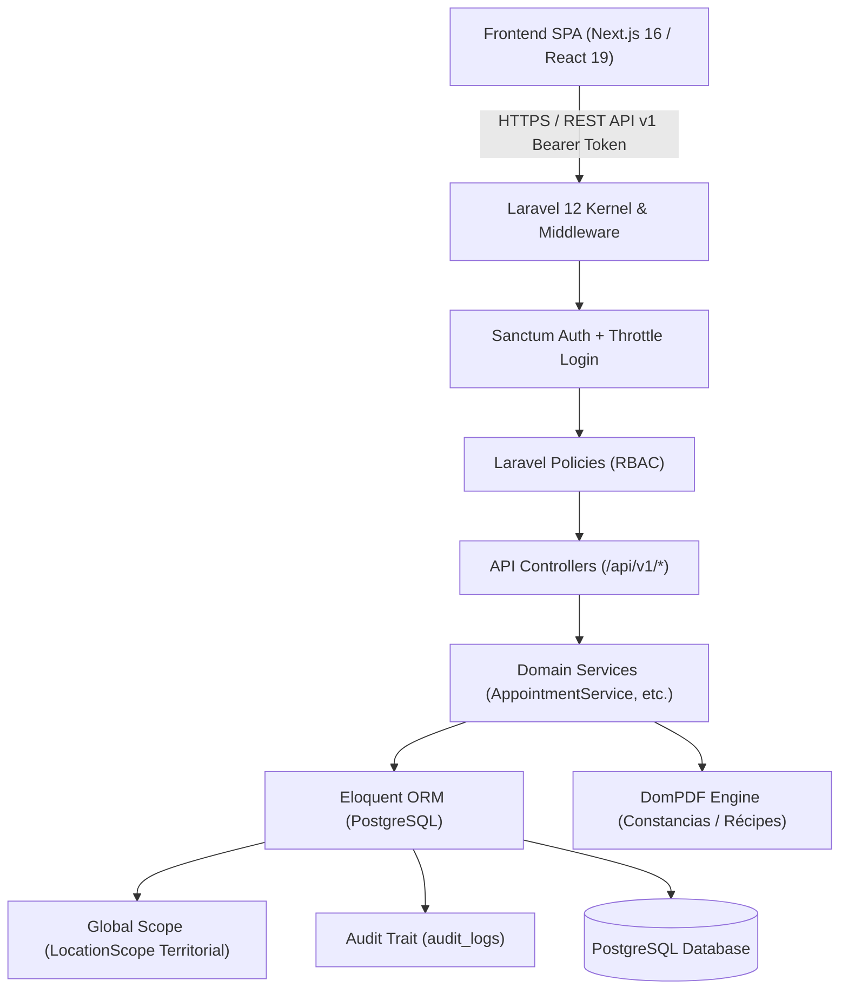

# 🏛️ MANIFEST MAESTRO DEL SISTEMA — SALUDMERCAL

> **Documento Central de Arquitectura, Dominio, Reglas de Negocio y Especificación Técnica**  
> **Versión del Manifiesto:** 1.1.0 (conciliado con el código real; ver `DIAGNOSTICO_INTEGRAL_SALUDMERCAL.md`)  
> **Última Actualización:** 2026-10-18  
> **Audiencia:** Desarrolladores, Arquitectos de Software, Auditores Técnicos y Agentes de IA.

---

## 📑 TABLA DE CONTENIDOS

1. [Identidad del Sistema y Contexto Institucional](#1-identidad-del-sistema-y-contexto-institucional)
2. [Propósito, Alcance y Problema que Resuelve](#2-propósito-alcance-y-problema-que-resuelve)
3. [Stack Tecnológico Integral](#3-stack-tecnológico-integral)
4. [Arquitectura de Software y Topología](#4-arquitectura-de-software-y-topología)
5. [Modelo de Seguridad, IAM y Roles (RBAC)](#5-modelo-de-seguridad-iam-y-roles-rbac)
6. [Reglas de Negocio Inmutables](#6-reglas-de-negocio-inmutables)
7. [Módulos del Sistema y Flujos Operativos](#7-módulos-del-sistema-y-flujos-operativos)
8. [Modelo de Datos y Diccionario de Entidades](#8-modelo-de-datos-y-diccionario-de-entidades)
9. [Directrices de Desarrollo y Mantenimiento](#9-directrices-de-desarrollo-y-mantenimiento)
10. [Guía de Arranque Rápido y Credenciales Sembradas](#10-guía-de-arranque-rápido-y-credenciales-sembradas)
11. [Brechas Conocidas entre Diseño e Implementación](#11-brechas-conocidas-entre-diseño-e-implementación)

---

## 1. IDENTIDAD DEL SISTEMA Y CONTEXTO INSTITUCIONAL

- **Nombre Oficial:** SaludMercal
- **Organización Propietaria:** Mercados de Alimentos C.A. (MERCAL)
- **Ente Rector:** Ministerio del Poder Popular para la Alimentación (MINPPAL) — República Bolivariana de Venezuela.
- **Tipo de Sistema:** Plataforma Web Integral de Gestión Médica, Salud Ocupacional, Expediente Clínico Electrónico (ECE) y Convalidación de Reposos para Trabajadores y Carga Familiar.
- **Topología del Repositorio:** Monorepo desacoplado:
  - `frontend/`: Single Page Application (SPA) / SSR moderna con Next.js App Router.
  - `backend/`: API RESTful v1 robusta en Laravel con persistencia en PostgreSQL.

---

## 2. PROPÓSITO, ALCANCE Y PROBLEMA QUE RESUELVE

### 2.1 El Contexto de Mercal C.A.
Mercal C.A. cuenta con una plantilla humana distribuida en toda la geografía venezolana, que abarca personal en Sede Central (Caracas), 24 estados federales, centros de acopio, almacenes refrigerados, centros de distribución masiva y flota de transporte. Garantizar el bienestar y la atención médica oportuna de miles de trabajadores y sus núcleos familiares requiere una gestión asistencial y ocupacional coordinada y descentralizada.

### 2.2 Problemas Preexistentes
1. **Dispersión y Vulnerabilidad de Documentos:** Reposos médicos físicos propensos a extravío, deterioro o entrega extemporánea, generando fricción con la Dirección de Gestión Humana y retrasos en nómina.
2. **Falta de Trazabilidad Clínica:** Expedientes en carpetas físicas no disponibles si un trabajador se traslada de sede o requiere atención de urgencia en otra región.
3. **Agendamiento Ineficiente y Ausentismo:** Asignación manual de turnos con alto riesgo de doble reserva (solapamiento) y falta de recordatorios o triaje formal.
4. **Desprotección de la Carga Familiar:** Ausencia de un canal formal para extender los servicios de salud institucionales a los beneficiarios directos (cónyuge, hijos, padres).
5. **Aislamiento Territorial Débil:** Riesgo de fuga de información privada médica entre estados sin separación de privilegios por sede.

### 2.3 Solución que Brinda SaludMercal
- **Expediente Clínico Electrónico Único:** Historial médico consolidado por paciente (consultas, diagnósticos, constantes vitales, alergias, tipo de sangre y exámenes).
- **Portal de Autogestión del Empleado (`/portal`):** Los trabajadores consultan su historial, solicitan citas para sí mismos o sus beneficiarios, gestionan reposos y visualizan su perfil en tiempo real.
- **Convalidación Digital de Reposos Médicos:** Flujo digital auditable de solicitud, revisión médica, dictamen y generación automatizada de constancias institucionales en PDF con código QR y serial verificable.
- **Agenda Médica Inteligente Anti-Solapamiento:** Algoritmo y constraints a nivel de base de datos que impiden dobles reservas para un mismo especialista en el mismo bloque temporal.
- **Protección de Datos Médicos (IAM Estricto):** Segregación total entre la administración técnica de usuarios (Seguridad Lógica) y la confidencialidad clínica (Médicos/Enfermería).
- **Multisede con Aislamiento Territorial:** Cobertura de 25 sedes sembradas: el grupo Caracas (Sede Central, Capital y Vargas, con datos compartidos) y 22 sedes estatales aisladas, garantizando que el personal de una sede regional solo administre a pacientes y citas de su jurisdicción geográfica.

---

## 3. STACK TECNOLÓGICO INTEGRAL

### 3.1 Backend
- **Lenguaje:** PHP `^8.2` según `composer.json` (verificado en PHP 8.5.11)
- **Framework:** Laravel 12 (Arquitectura RESTful API v1)
- **Base de Datos:** PostgreSQL 15+ (con soporte para transacciones ACID e índices parciales condicionales)
- **Autenticación:** Laravel Sanctum con tokens Bearer. El token expira a los `session_timeout_minutes` del usuario (5/20/30/60, por defecto 30) **contados desde el login, sin renovación por actividad**; `SANCTUM_EXPIRATION=480` es solo el tope global. Un único token `spa-token` por usuario (el login anterior se revoca). Revocación al cerrar sesión, cambiar/resetear clave, desactivar o eliminar la cuenta. Rate limiting: `login` = 5/min por login+IP y 20/min por IP; `api` = 120/min por usuario.
- **Generación de Documentos:** `barryvdh/laravel-dompdf` (resumen/récipe de consulta, constancias de reposo y reporte ejecutivo en PDF A4; generación síncrona dentro del request). La constancia **no incluye QR**: solo un código textual `HASH-…` sin endpoint de verificación.
- **Pruebas:** PHPUnit — 69 tests Feature / 256 aserciones sobre SQLite `:memory:` (no hay tests Unit ni de concurrencia real; producción usa PostgreSQL).
- **Gestor de Paquetes PHP:** Composer 2.x

### 3.2 Frontend
- **Framework:** Next.js 16.3.8 (App Router, Turbopack, React 19.2.8)
- **Lenguaje:** TypeScript 5 (modo estricto; objetivo de cero `any`, hoy queda 1 `as any` en `NuevoPacienteModal.tsx`)
- **Estilos & Diseño:** Tailwind CSS v4, Lucide React (iconografía premium), soporte dinámico Modo Claro / Modo Oscuro mediante tokens semánticos HSL.
- **Estado Global:** Zustand 5 (stores modulares: `auth`, `pacientes`, `examenes`, `citas`, `reposos`, `medicos`, `usuarios`). El store de auth persiste `user` en `localStorage` y se revalida contra `/auth/me` al hidratar.
- **Formularios & Validación:** React Hook Form + Zod **v4** (`^4.6.5`).
- **Cliente HTTP:** Capa centralizada tipada (`frontend/src/lib/api.ts`) con intercepción global de 401 (limpia el token y emite el evento `saludmercal:unauthorized`). El token Bearer se guarda en `localStorage`. No hay manejo global de 403.
- **Pruebas Frontend:** Vitest + React Testing Library + JSDOM — 48 tests en 9 archivos (stores, esquemas, utilidades, 1 componente). `pnpm lint` presenta 8 errores abiertos.
- **Gestor de Paquetes JS:** **PNPM** (Uso obligatorio. **PROHIBIDO USAR NPM** según directrices del proyecto).

---

## 4. ARQUITECTURA DE SOFTWARE Y TOPOLOGÍA

El sistema implementa una arquitectura desacoplada basada en micro-capas y patrones de diseño SOLID:



### 4.1 Principios de Diseño (estado real)
- **Separación de responsabilidades:** `FormRequest` para validación, `JsonResource` para transformación y `Services` para negocio. Servicios existentes: `AppointmentService` y `MedicalExamStorage`; la lógica de pacientes/beneficiarios, reposos y reportes sigue en los controladores.
- **Open/Closed Principle (OCP):** La auditoría y los scopes de ubicación se aplican mediante Traits (`Auditable`, `BelongsToLocation`, `SearchesColumns`) y los catálogos comparten `CatalogController`/`CatalogPolicy`. Las policies repiten condiciones de sede (candidato a refactor).
- **Enums tipados:** `UserRole`, `AppointmentStatus` (con máquina de transiciones), `MedicalLeaveStatus`, `MedicalLeaveType`, `Gender`.
- **Recursos API:** `PatientResource`, `PatientBeneficiaryResource`, `AppointmentResource`, `DoctorResource`, `MedicalLeaveResource`, `MedicalExamResource`, `UserResource`, `CatalogResource`, `AuditLogResource`. Aún no hay recursos distintos por audiencia (staff vs. empleado).
- **Inyección de dependencias:** vía constructor/método de controladores Laravel; los servicios se inyectan por clase concreta (sin interfaces).

---

## 5. MODELO DE SEGURIDAD, IAM Y ROLES (RBAC)

La plataforma aplica el principio de **menor privilegio** y estricta confidencialidad médica conforme a la legislación nacional de salud y protección de datos.

### 5.1 Roles del Sistema (`App\Enums\UserRole`)

| Rol (`role`) | Denominación | Alcance Territorial | Acceso a Datos Clínicos | Responsabilidades Principales |
|---|---|---|---|---|
| `super_admin` | Administrador General (institucional) | **Nacional** (Todas las Sedes) | Sí (Auditoría/Supervisión) | Control global, gestión de sedes, especialidades, catálogos, reportes ejecutivos nacionales y todos los usuarios. (Nota: hoy el `admin` de sede también puede escribir catálogos — ver §11.) |
| `logical_security` | Seguridad Lógica (OTIC) | **Nacional** | **NO (Estrictamente Bloqueado)** | Gestión y reseteo de cuentas, políticas de caducidad de contraseñas y tiempo de sesión. **No tiene permiso de lectura sobre diagnósticos ni pacientes** y, hoy, **tampoco accede a `/audit-logs`** (devuelve 403). |
| `developer` | Desarrollador (Soporte técnico) | **Nacional, solo lectura** | **Solo con Acceso de Emergencia** (motivo ≥ 20 caracteres, 30 min, auditado) | Diagnóstico y soporte: bitácora técnica, configuración y lectura. **Nunca crea, edita ni elimina**; en producción un middleware rechaza cualquier método no seguro. Oculto en los listados de usuarios (solo lo ve `logical_security`, que únicamente puede activarlo/desactivarlo). Se aprovisiona solo por seeder, desactivado en producción. |
| `admin` | Administrador de Sede | **Local** (Su sede asignada) | Sí (Gestión médica de sede) | Coordinación médica de la sede, gestión de personal médico/enfermería, revisión y convalidación de reposos médicos de su región. |
| `doctor` | Médico Especialista | **Local** (su sede) | Sí (ve **todos los pacientes de su sede**; solo las citas asignadas a él) | Iniciar/completar/marcar inasistencia de sus citas, revisar reposos de su sede, cargar exámenes. La disponibilidad y horarios los administra el `admin`. |
| `nurse` | Personal de Enfermería | **Local** (Sede asignada) | Sí (lectura clínica de su sede) | Confirmar citas, iniciar atención y cargar exámenes. **El registro de signos vitales/triaje aún no está implementado.** |
| `receptionist` | Recepcionista / Admisión | **Local** (Sede asignada) | Limitado (Administrativo) | Registro y actualización de pacientes, carga de beneficiarios familiares, asignación presencial y telefónica de citas. |
| `employee` | Empleado / Paciente | **Individual** (Personal + Familiar) | Sí (Solo su propio expediente) | Portal del trabajador (`/portal`): consulta de citas, solicitud de citas para sí o familiares, consulta de reposos y expediente. |

### 5.2 Políticas de Seguridad Informática Activas
- **Rotación de Contraseñas:** Parámetro configurable por usuario (`password_expiration_months`: 3, 6 o 12 meses) con cálculo de `password_expires_at`.
- **Tiempo de Sesión:** configuración individual (`session_timeout_minutes`: 5, 20, 30, 60). Funciona como **vida máxima del token desde el login** (no como cierre por inactividad; no hay temporizador de inactividad en el frontend).
- **Forzado de Cambio de Clave:** Bandera `must_change_password` para primer ingreso o restablecimiento administrativo.
- **Protección contra Fuerza Bruta:** throttling `login` (5/min por login+IP, 20/min por IP). No hay bloqueo de cuenta tras N fallos ni historial de contraseñas.
- **Acceso de Emergencia (break-glass):** `POST/GET/DELETE /api/v1/emergency-access` (solo `developer`). Sin una ventana abierta, el desarrollador recibe 403/vacío en pacientes, citas, reposos, exámenes y reportes, y solo ve en la bitácora los eventos de `User` y de accesos de emergencia. Dentro de la ventana cada petición queda registrada (`event = accessed`, método, ruta, estado) además de la apertura (con motivo) en `emergency_accesses`.
- **Trazabilidad Forense:** Las mutaciones (create/update/delete) de `User`, `Patient`, `PatientBeneficiary`, `Doctor`, `Appointment`, `MedicalLeave` y `MedicalExam` generan registro en `audit_logs` (IP, usuario, valores anteriores/nuevos en JSON; se excluyen `password`/campos ocultos). Solo los **exámenes médicos** registran además lecturas (`viewed`/`downloaded`). `audit_logs` no tiene `location_id` y `admin`/`super_admin` leen todo.

---

## 6. REGLAS DE NEGOCIO INMUTABLES

Cualquier cambio o desarrollo futuro en la plataforma debe respetar las siguientes directrices estructurales:

### 6.1 Regla "Empleado = Paciente"
- En SaludMercal, todo trabajador de la institución es potencialmente un paciente.
- La tabla `users` con rol `employee` se vincula biunívocamente (1:1) con la tabla `patients` a través de la clave foránea `patients.user_id`.
- Cuando un empleado inicia sesión en el frontend, el sistema detecta su rol y lo redirige automáticamente al **Portal del Empleado** (`/portal`), resolviendo de forma transparente su `patient_id` subyacente.

### 6.1b Origen de los Pacientes: Nómina Corporativa (Directorio de Empleados)
- Todo paciente es un empleado, pero no todo empleado es paciente: el expediente se abre **por demanda** con «Nuevo Paciente → Buscar empleado por cédula» (`POST /patients/directory-lookup` y `/patients/from-directory`), sin cargar masivamente los ~6.000 empleados.
- La fuente es una vista de solo lectura de la BD central (`EmployeeDirectory`: driver `database` con `config/employee_directory.php` y la conexión `central`; driver `local` con la tabla de prueba `directory_employees` mientras no exista la vista). La **sede/estado** del empleado en la nómina determina su sede (`SedeResolver`: por nombre, código o estado, o alias en config); si no tiene equivalencia no se puede importar.
- Se guarda un snapshot local (`patients.source = 'directory'`, `employment_active`, `directory_synced_at`). Cédula, nombres, nacimiento, sexo, cargo, departamento y sede son de **solo lectura**; se editan localmente teléfono/correo y toda la ficha médica. `patients:sync-directory` (diario 02:00) y `POST /patients/{id}/sync-directory` refrescan los datos, incluida la sede (queda en la bitácora).
- El personal solo abre expedientes de empleados de su sede/grupo (recepción y admin); para otras sedes se usa la comisión de servicio, que también abre el expediente desde la nómina con su sede de origen. Alta manual (`POST /patients`, `source = 'manual'`): solo `admin`/`super_admin`, como excepción para quien no figura en la nómina.
- Las búsquedas por cédula se limitan (20/min por usuario) y se auditan (`directory_lookup`) para evitar enumerar la nómina.

### 6.2 Regla de Aislamiento Territorial Multisede (`LocationScope`)
- Hay 25 sedes sembradas. **Grupo `caracas`** (`locations.location_group`): Sede Central (`is_headquarters = true`), Capital y Vargas. Las sedes de un mismo grupo comparten pacientes, médicos/agendas, citas, reposos, exámenes, usuarios y bitácora (`User::accessibleLocationIds()`); el resto de estados son grupos de una sola sede.
- **Citas entre sedes:** un trabajador puede pedir cita con un médico de otra sede. La cita pertenece a la sede donde se atiende (`appointments.location_id`) y la sede de origen del paciente la ve siempre (historial completo). La sede de atención ve al paciente solo con datos básicos (`is_visiting`): sin reposos ni exámenes de su sede de origen, y sin poder editarlo.
- **Comisión de servicio (`service_commissions`):** la recepción (o admin) de la sede destino registra al trabajador por cédula (`POST /service-commissions`); no tiene vencimiento y puede cerrarse (`/end`) por la sede destino o por el admin de la sede de origen. El paciente conserva su sede de origen y puede atenderse en cualquier sede; los reportes de la sede destino cuentan sus citas completadas como **«Citas atendidas de otras sedes»**, desglosadas por sede de origen (`appointments.from_other_sedes` en `/reports/summary`).
- El scope global `App\Models\Scopes\LocationScope` (trait `BelongsToLocation`) filtra por `location_id` los modelos `Patient`, `Doctor`, `Appointment`, `MedicalLeave` y `MedicalExam` para el staff. Los usuarios (`User`) se filtran manualmente en `UserController`; `PatientBeneficiary`, `AuditLog` y los catálogos no tienen scope. Si un usuario staff tiene `location_id = null`, el scope **no filtra** (ver §11). Los `employee` están exentos del scope (se restringen por `visibleTo`/propiedad).
- Solo `super_admin` posee exención territorial global para monitoreo nacional.

### 6.3 Regla de Extensión a Beneficiarios Familiares
- Cada paciente/empleado puede tener asociados múltiples beneficiarios familiares directos (`patient_beneficiaries`). El parentesco se valida solo en el frontend (en BD es texto libre).
- **Parentescos válidos:** Cónyuge (`conyuge`), Hijo (`hijo`), Hija (`hija`), Padre (`padre`), Madre (`madre`).
- **Permiso de Carga:** Por política de auditoría y control de nómina, los beneficiarios **NO son registrados directamente por el empleado**. Son gestionados y dados de alta por el **Administrador de Sede** o el **Recepcionista** dentro de la ficha de edición del paciente.
- **Visibilidad:** El empleado puede visualizar a su grupo familiar en su portal (`/portal/perfil`) en modo de solo lectura.
- **Citas para Beneficiarios:** Al solicitar una cita en `/portal/citas`, el empleado titular puede seleccionar si la cita médica es para él mismo o para cualquiera de sus beneficiarios registrados.

### 6.4 Regla Anti-Solapamiento en Agendas Médicas (Garantía DB)
- Ningún médico puede tener dos citas solapadas en el mismo horario.
- La validación opera en dos capas defensivas:
  1. **Capa de Aplicación (`AppointmentService`):** bajo `lockForUpdate` sobre el médico, valida horario laboral del día, ausencia de `doctor_time_offs`, que el inicio sea un slot libre y futuro, y que el paciente no tenga otra cita a la misma hora.
  2. **Capa de Base de Datos (PostgreSQL):** Restricción mediante índice único condicional:
     ```sql
     CREATE UNIQUE INDEX appointments_active_slot_unique
     ON appointments (doctor_id, scheduled_date, start_time)
     WHERE status IN ('pending', 'confirmed', 'in_progress') AND deleted_at IS NULL;
     ```
- Las cancelaciones o inasistencias (`cancelled`, `no_show`) —y las citas `completed`— liberan el bloque horario.
- **Alcance real:** el índice impide dos citas activas con el **mismo** `start_time`; no existe una restricción por rango, por lo que un cambio de `slot_duration_minutes` o una reprogramación podría producir citas parcialmente solapadas (ver §11).

### 6.5 Regla de Reposos Médicos y Convalidación Institucional
- La plataforma gestiona ausentismo laboral con 4 tipos de reposo (`MedicalLeaveType`): `occupational` (ocupacional), `accident` (accidente), `illness` (enfermedad) y `maternity` (maternidad).
- Todo reposo cargado por el empleado o médico adjunta su comprobante en almacenamiento privado protegido (`storage/app/private/medical-leaves/*`; los exámenes en `storage/app/private/medical-exams/{patient_id}/*`), inaccesible vía URLs públicas.
- Solo `super_admin` y, dentro de su sede, `admin` o `doctor` pueden emitir el dictamen (`approved` o `rejected`); un reposo ya revisado no puede revisarse de nuevo (409). Cualquier rol no-`logical_security` puede crear un reposo; el empleado solo para sí mismo y solo puede eliminar los pendientes propios.
- Al aprobarse, está disponible una **Constancia de Convalidación en PDF** (endpoint `/medical-leaves/{id}/certificate`) con un código de verificación textual. **No incluye QR ni verificación pública** (ver §11).

---

## 7. MÓDULOS DEL SISTEMA Y FLUJOS OPERATIVOS

### 7.1 Portal Administrativo y Clínico (`/(dashboard)`)
Ruta base del personal operativo y directivo:

1. **Dashboard Principal (`/`):** indicadores del rango (citas totales/hoy, tasa de finalización, citas por estado/especialidad/médico, pacientes totales/activos, reposos pendientes y aprobados del rango), alimentados por `GET /reports/summary` (solo roles staff).
2. **Módulo de Pacientes (`/pacientes`):** Búsqueda por cédula, nombre o sede. Modal moderno de alta/edición en 4 secciones:
   - Datos Personales (Cédula, Nombres, Apellidos, Sexo, Nacimiento, Teléfono, Correo).
   - Datos Laborales (Departamento institucional, Sede Mercal, Cargo). Además la ficha de detalle (`/pacientes/[id]`) incluye historial de citas, reposos y pestaña de **Exámenes Médicos**.
   - Ficha Médica de Emergencia (Grupo Sanguíneo, Alergias, Nombre y Teléfono de Contacto de Emergencia).
   - Grupo Familiar (Gestor integrado de beneficiarios: alta, edición y baja de familiares directos).
3. **Módulo de Citas (`/citas`):** Agenda interactiva de turnos médicos con filtros por médico, especialidad, fecha y estado. Acciones de confirmación, inicio de atención, cancelación y registro de inasistencia.
4. **Módulo de Médicos (`/medicos`):** Directorio de profesionales de la salud, configuración de consultorio, especialidad primaria y secundarias, horarios semanales por día y registro de permisos/vacaciones (`time_offs`).
5. **Módulo de Reposos Médicos (`/reposos`):** Bandeja de auditoría y convalidación. Permite ver diagnósticos, previsualizar el documento adjunto original en visor seguro, aprobar o rechazar con notas médicas justificativas, y descargar la constancia institucional en PDF.
6. **Módulo de Reportes (`/reportes`):** Exportación de analíticas para la Dirección de Gestión Humana:
   - Citas por especialidad y por médico (todas las citas del rango, no solo las atendidas).
   - Ausentismo (reposos aprobados y días acumulados) **por departamento**, solo en el PDF.
   - Formatos: PDF Ejecutivo y CSV (citas + reposos). **El CSV tiene defectos conocidos** (columna `scheduled_time` inexistente, tipo de reposo sin convertir de Enum); ver §11.
7. **Módulo de Seguridad y Usuarios (`/usuarios`):** `super_admin` y `logical_security` (alcance nacional) y también `admin` (limitado a su sede). Creación de cuentas, asignación de roles, activación/desactivación y reseteo forzado de credenciales. Un `super_admin` solo ve su propia cuenta entre los `super_admin`. `logical_security` se redirige siempre a esta pantalla.
8. **Bitácora (`GET /api/v1/audit-logs`):** endpoint disponible para `admin`/`super_admin`; no tiene pantalla dedicada en el frontend.

### 7.2 Portal del Empleado (`/portal`)
Entorno autocontenido y responsivo para el trabajador:

1. **Mi Resumen (`/portal`):** Vista rápida de la próxima cita programada, últimos reposos tramitados y acceso directo a servicios.
2. **Mis Citas (`/portal/citas`):** Historial cronológico de citas pasadas y activas. Modal de solicitud de cita para el titular o uno de sus beneficiarios (sede, especialidad, médico y horario disponible). **Defecto conocido:** la cita se guarda con la sede del empleado y no con la del médico (ver §11).
3. **Mi Expediente (`/portal/expediente`):** consultas (citas), descarga del resumen/récipe de citas completadas, reposos con su diagnóstico reportado y exámenes cargados. No existe aún un registro clínico estructurado (diagnóstico CIE‑10, indicaciones) por consulta.
4. **Mis Reposos Médicos (`/portal/reposos`):** Consulta de estado de reposos solicitados, descarga de constancias aprobadas en PDF y modal para someter un nuevo reposo con carga de archivo digital.
5. **Mi Perfil (`/portal/perfil`):** Ficha del trabajador con información personal, departamento y cargo, ficha médica de emergencia y la visualización de su **Grupo Familiar (Beneficiarios)**.

---

## 8. MODELO DE DATOS Y DICCIONARIO DE ENTIDADES

Base de datos relacional PostgreSQL con integridad referencial estricta:

```
┌─────────────────┐       ┌─────────────────┐       ┌─────────────────┐
│    locations    │◄──────│      users      │──────►│   audit_logs    │
└─────────────────┘       └─────────────────┘       └─────────────────┘
         ▲                         ▲
         │                         │ (1:1 con employee)
┌─────────────────┐       ┌─────────────────┐       ┌────────────────────────┐
│   departments   │◄──────│    patients     │──────►│  patient_beneficiaries │
└─────────────────┘       └─────────────────┘       └────────────────────────┘
                                   │                              ▲
                                   │                              │ (opcional)
                                   ▼                              │
┌─────────────────┐       ┌─────────────────┐                     │
│  specialties    │◄──────│  appointments   │─────────────────────┘
└─────────────────┘       └─────────────────┘
         ▲                         │
         │                         ▼
┌─────────────────┐       ┌─────────────────┐       ┌─────────────────┐
│     doctors     │──────►│  medical_leaves │       │  medical_exams  │
└─────────────────┘       └─────────────────┘       └─────────────────┘
```

### 8.1 Catálogo de Tablas Principales

| Tabla | Propósito y Descripción | Llaves Foráneas / Relaciones Clave |
|---|---|---|
| `users` | Cuentas de acceso, credenciales, políticas IAM (`password_expiration_months`, `session_timeout_minutes`, `must_change_password`, `last_login_*`) y rol. Soft deletes. | `location_id -> locations.id` (nullable) |
| `locations` | Sedes Mercal; `location_group` agrupa sedes que comparten datos (grupo `caracas`: Sede Central, Capital, Vargas). | — |
| `departments` | Departamentos organizacionales de Mercal (Logística, Almacén, RRHH, etc.). | — |
| `specialties` | Especialidades médicas ofertadas (Medicina General, Pediatría, Cardiología, etc.). | — |
| `patients` | Ficha técnica y médica del paciente/trabajador. | `user_id -> users.id`, `location_id -> locations.id`, `department_id -> departments.id` |
| `directory_employees` | Tabla de prueba de la nómina para el driver `local` (en producción se lee la vista central). | — |
| `patient_beneficiaries`| Familiares directos del trabajador (nombre, parentesco, cédula, nacimiento, sexo, teléfono, activo). Soft deletes. | `patient_id -> patients.id` (Cascade On Delete) |
| `doctors` | Registro de profesionales médicos, código de colegiatura/MPPS y consultorio. | `user_id -> users.id`, `specialty_id -> specialties.id`, `location_id -> locations.id` |
| `doctor_specialty` | Tabla pivote para soporte de múltiples especialidades médicas por doctor. | `doctor_id`, `specialty_id` |
| `doctor_schedules` | Horarios semanales de consulta (día de semana, hora inicio, hora fin). | `doctor_id -> doctors.id` |
| `doctor_time_offs` | Días no laborables, permisos o vacaciones del médico. | `doctor_id -> doctors.id` |
| `service_commissions` | Comisiones de servicio: trabajador de otra sede atendido temporalmente en `location_id` (destino). Sin vencimiento; `ended_at` la cierra. | `patient_id`, `location_id`, `registered_by -> users.id` |
| `appointments` | Citas médicas agendadas, atendidas o canceladas. | `patient_id`, `beneficiary_id`, `doctor_id`, `specialty_id`, `location_id` |
| `appointment_status_histories` | Trazabilidad de cambios de estado de cada cita médica. | `appointment_id -> appointments.id`, `changed_by -> users.id` |
| `medical_leaves` | Reposos médicos, diagnósticos, días de incapacidad y dictámenes. | `patient_id`, `doctor_id`, `location_id`, `reviewed_by -> users.id` |
| `medical_exams` | Exámenes médicos y paraclínicos asociados a un paciente. | `patient_id`, `specialty_id`, `location_id`, `uploaded_by -> users.id` |
| `medical_exam_files` | Archivos adjuntos digitales (imágenes, PDFs) de exámenes médicos. | `medical_exam_id -> medical_exams.id` |
| `personal_access_tokens` | Tokens Sanctum (`spa-token`) con expiración. | `tokenable` polimórfico |
| `sessions`, `password_reset_tokens`, `cache`, `jobs` | Tablas de framework creadas; la autenticación usa tokens, no sesiones, y no existe reseteo por correo. | — |
| `emergency_accesses` | Ventanas de acceso de emergencia del desarrollador (motivo, IP, `expires_at`, `ended_at`). | `user_id -> users.id` |
| `audit_logs` | Registro de mutaciones (y lecturas de exámenes) con `event`, `auditable_type/id`, `old_values`, `new_values`, `ip_address`. **Sin `location_id`.** | `user_id -> users.id` |

---

## 9. DIRECTRICES DE DESARROLLO Y MANTENIMIENTO

Para garantizar la estabilidad del proyecto y el orden del repositorio, se deben cumplir obligatoriamente las siguientes directrices:

### 9.1 Uso Exclusivo de PNPM
- **Queda estrictamente prohibido ejecutar `npm install` o `npm run`** en el frontend.
- Todo comando de frontend debe ejecutarse mediante `pnpm` (ejemplo: `pnpm dev`, `pnpm run build`, `pnpm exec tsc --noEmit`, `pnpm test`).

### 9.2 Regla Inviolable de Base de Datos: NO Migraciones Incrementales
- Durante la fase activa de desarrollo, **está prohibido crear migraciones incrementales** (ejemplo: `add_field_to_table.php`).
- Si se requiere añadir columnas, llaves foráneas o índices, **se debe editar directamente el archivo de migración `create_*` original** correspondiente.
- Posteriormente, se debe regenerar la base de datos limpia ejecutando:
  ```bash
  cd backend && php artisan migrate:fresh --seed
  ```
- Esta regla mantiene el repositorio pulcro, previene deuda técnica y garantiza que el esquema se reconstruya de forma determinista y predecible.
- **Importante:** la regla aplica solo a la fase de desarrollo. Antes del primer despliegue con datos reales debe congelarse el esquema y pasar a migraciones incrementales.

### 9.3 Tipado Estricto y Calidad de Código
- En el frontend no se admiten tipos `any`. Toda entidad o payload de la API debe estar respaldado por interfaces TypeScript completas en `frontend/src/types/`.
- Antes de dar por finalizada cualquier tarea o cambio en el frontend, se debe comprobar la integridad del código ejecutando (añadir también `pnpm lint`, hoy con errores abiertos):
  ```bash
  pnpm --dir frontend exec tsc --noEmit
  pnpm --dir frontend run build
  pnpm --dir frontend test
  ```

---

## 10. GUÍA DE ARRANQUE RÁPIDO Y CREDENCIALES SEMBRADAS

### 10.1 Comandos de Arranque

```bash
# Terminal 1 — Backend (Laravel API)
cd backend
composer install
php artisan key:generate
php artisan migrate:fresh --seed
php artisan serve --port=8000

# Terminal 2 — Frontend (Next.js SPA)
cd frontend
pnpm install
pnpm dev --port=3000
```

### 10.2 Cuentas de Acceso Sembradas en Base de Datos

Todas las cuentas se inicializan con la contraseña estándar de desarrollo (`SEED_DEFAULT_PASSWORD`, por defecto la siguiente) y `must_change_password = false`. **`DatabaseSeeder` no distingue entorno: no debe ejecutarse en producción.**  
🔑 **Contraseña:** `Password123*`

| Rol / Perfil | Usuario (`username`) | Correo Institucional | Sede Asignada |
|---|---|---|---|
| **Desarrollador (Soporte)** | `desarrollador` | `desarrollador@mercal.gob.ve` | Nacional (solo lectura; en producción se crea desactivado con `SEED_DEVELOPER_*`) |
| **Super Administrador** | `moicastillo` | `moicastillo@mercal.gob.ve` | Sede Central (Nacional) |
| **Seguridad Lógica (OTIC)** | `seguridad.logica` | `seguridad.logica@mercal.gob.ve` | Sede Central (Nacional IAM) |
| **Admin Sede Central** | `admin` | `admin@mercal.gob.ve` | Sede Central Caracas |
| **Admin Regional (Zulia)** | `admin.zulia` | `admin.zulia@mercal.gob.ve` | Sede Zulia (Maracaibo) |
| **Recepción Central** | `recepcion` | `recepcion@mercal.gob.ve` | Sede Central Caracas |
| **Recepción Regional (Zulia)** | `recepcion.zulia` | `recepcion.zulia@mercal.gob.ve` | Sede Zulia (Maracaibo) |
| **Enfermería / Triaje** | `enfermeria` | `enfermeria@mercal.gob.ve` | Sede Central Caracas |
| **Médico (Med. General)** | `carlos.mendoza` | `carlos.mendoza@mercal.gob.ve` | Sede Central Caracas |
| **Médico (Cardiología)** | `elena.salazar` | `elena.salazar@mercal.gob.ve` | Sede Central Caracas |
| **Médico (Traumatología)** | `roberto.garcia` | `roberto.garcia@mercal.gob.ve` | Sede Central Caracas |
| **Paciente / Empleado Titular** | `empleado` | `empleado@mercal.gob.ve` | Sede Central (Beneficiarios cargados) |
| **Paciente / Empleada Secundaria** | `maria.gonzalez` | `maria.gonzalez@mercal.gob.ve` | Sede Central |

> [!TIP]
> En la pantalla de Login (`/login`) existe una **barra de acceso rápido por rol** que inicia sesión con `Password123*`. Hoy **no está condicionada al entorno** y se compila también en producción (ver §11).

---
---

## 11. BRECHAS CONOCIDAS ENTRE DISEÑO E IMPLEMENTACIÓN

> **Actualización:** la Fase 1 del diagnóstico (2026-10-18) ya corrigió: escritura de catálogos solo `super_admin`, bitácora por sede (`audit_logs.location_id`; `logical_security` ve solo eventos de `User`), validación de beneficiarios, sede de cita = sede del médico, scope fail-closed (staff sin sede no ve nada y `UserRequest` exige sede), zona horaria `America/Caracas`, CSV de reportes, seeders de producción y acceso rápido solo en desarrollo. Las viñetas siguientes que contradigan esto son históricas; el detalle está en §9 del diagnóstico.

Verificadas el 2026-10-18; detalle, evidencia y plan en [`DIAGNOSTICO_INTEGRAL_SALUDMERCAL.md`](./DIAGNOSTICO_INTEGRAL_SALUDMERCAL.md).

**Seguridad / aislamiento (confirmadas con pruebas de sondeo)**
- El `admin` de una sede puede eliminar catálogos nacionales (`CatalogPolicy`) y leer la bitácora de **todas** las sedes (`AuditLogPolicy`, sin `location_id`).
- Un empleado puede adjuntar a su cita el `beneficiary_id` de otro paciente y ver sus datos.
- Las citas de un empleado se guardan con la sede del empleado (no la del médico) y quedan invisibles para el médico.
- `LocationScope` y las policies fallan abiertas cuando el staff tiene `location_id = null`.
- Seeders con contraseña conocida sin barrera de producción; barra de acceso rápido incluida en el bundle de producción.
- Token Bearer en `localStorage`, sin cierre por inactividad, sin CSP ni cabeceras de seguridad.

**Funcionales**
- `config/app.php` fija la zona horaria en `UTC` (ignora `APP_TIMEZONE`): desfase de 4 h en horarios y "hoy".
- Exportación CSV de reportes defectuosa en PostgreSQL.
- Anti-solapamiento solo por `start_time` idéntico.
- Listados del frontend limitados a 100 registros (sin paginación en UI).

**Funcionalidades prometidas y no implementadas**
- QR / verificación pública de constancias; signos vitales y triaje; registro clínico estructurado (diagnóstico, indicaciones); cierre por inactividad; bloqueo de cuenta por intentos fallidos; auditoría de lecturas fuera de exámenes; pantalla de bitácora.

---
*Fin del Manifiesto Maestro de SaludMercal.*
